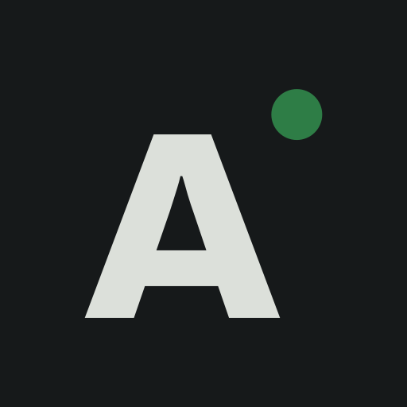
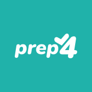

<h1 align="center">Hi, I'm Maciej Stefański 👋</h1>

  Founding Engineer @ Northhaven Analytics | AI/ML @ Bosch | Founder @ Aiegio, the context layer for AI 
  Research in context databases | Co-creator of SGHappka

  
  

I build AI products end to end: data, model, backend, deployment, and the part where people actually use them.

My research is in context databases: how to capture, store and retrieve what a company knows, so that AI gets the right context for a task, and only what that person is allowed to see.

## What I work on now

###  [Northhaven Analytics](https://northhavenanalytics.com/), Founding Engineer

Autonomous systems for healthcare operations: [mintHealth](https://northhavenanalytics.com/minthealth/), a procurement platform for ambulatory surgical centers, and [Brevio](https://northhavenanalytics.com/portfolio/#brevio), guided speech practice at home for patients after a tracheotomy.

### Bosch, AI/ML Developer

Python pipelines and neural networks for pattern recognition, clustering and standardization of large datasets.

###  [Aiegio](https://aiegio.com), Founder

Aiegio is first of all about context. It connects a company's projects, decisions, documents and past conversations, and gives Claude, ChatGPT and AI agents what they need for a task over MCP: search across all of it, per-person access and evaluations of whether the agent got the right context.

On the same platform: one company account for Claude, GPT and Gemini, with access control, budgets per department and an activity log. [Aiegio Steer](https://steer.aiegio.com) adds AI agents with shared project memory.

## Things I have shipped

<table>
  <tr>
    <td width="72" align="center"></td>
    <td><a href="https://sghappka.pl"><strong>SGHappka</strong></a> iOS and Android app for SGH students. 2,700+ regular users, 63 student organisations, 280 events. Co-creator, one of two lead developers.</td>
  </tr>
  <tr>
    <td width="72" align="center"></td>
    <td><a href="https://ksef.aiegio.com"><strong>KSeF AI Asystent</strong></a> MCP server that lets ChatGPT and Claude work with Poland's national e-invoicing system.</td>
  </tr>
  <tr>
    <td width="72" align="center"></td>
    <td><a href="https://prepfor.pl"><strong>Prep4 (prepfor.pl)</strong></a> Exam prep platform for SGH candidates. I wrote all code.</td>
  </tr>
  <tr>
    <td width="72" align="center"></td>
    <td><a href="https://tablicanakorepetycje.pl"><strong>tablicanakorepetycje.pl</strong></a> Free real-time whiteboard for tutoring. Solo.</td>
  </tr>
</table>

---

I study Quantitative Methods in Economics and Information Systems at SGH, so I look at the numbers and the business case, not only the code.

Happy to talk about AI agents and healthtech on [LinkedIn](https://www.linkedin.com/in/maciejstefanski44/).
